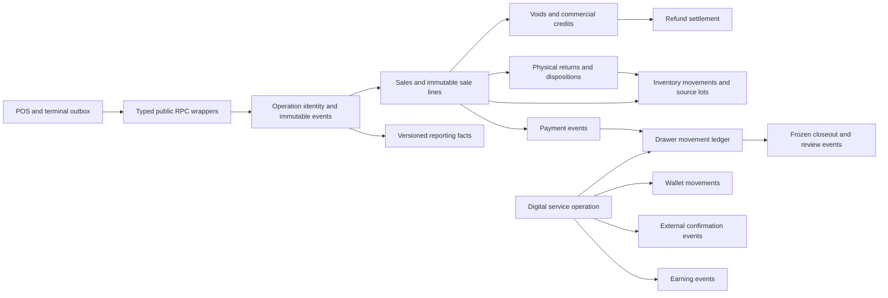

# Enhancement architecture

Status: proposed contracts, planning only. Read BUSINESS_RULES before implementing these contracts. Keep React/Vite + Zustand + Supabase; no new web framework, ORM, payment gateway, broker or printing service. New business logic lives in Postgres transactions, with thin typed frontend adapters. Edge Functions remain for privileged identity and, only in a future approved integration, external provider calls.

## A01 — Aggregate boundaries and relationships



- `sales` remains the commercial aggregate and `sale_items` historical line source. Do not introduce a replacement all-purpose `transactions` table.
- `pos_operations` is a shared command/idempotency envelope, not a second sales ledger. A sale, return, refund, void or digital step references it. One operation can emit many bounded accounting movements.
- `sale_adjustments` and `sale_adjustment_items` record immutable commercial credits for accepted return, approved void or goodwill. They carry line-level quantity/value/discount/VAT/COGS allocations. They are distinct from money handed back.
- Existing returns retain physical intake; `sale_refunds`/allocations track confirmed/reserved money reversal independently. A return can have zero, partial or full financial settlement; one refund may settle several credit lines from one sale. No refund crosses stores/sales.
- New `sale_void_requests`/lines plus decisions track proposed cancellation. `sale_voids`/lines are immutable applied cancellation evidence. Requests have no ledger effect.
- `cash_drawers`, `pos_terminals`, `cashier_shifts` identify custody. Cash movements reference actual performing shift. Existing `cashier_closeouts` holds frozen versioned report plus appended reviews/amendments.
- `digital_service_transactions` references a non-stock sale/service line for completed commercial display, but its principal/provider/cash legs are recorded separately. Create its sale shell/line only at completion (or use nullable sale link until complete); pending service records are not ordinary completed sales. Service face value is not ordinary merchandise revenue. Reports use service accounting classification.
- Existing `inventory_stock_lots`/allocations retain cost/ownership; new location balances become authoritative after gated cutover. `products.current_stock` and selling-option stock remain compatibility projections for default sellable location.
- Customer UUID links sales without changing receipt snapshots; all history uses store boundaries and explicit facts.

## A02 — Command contract and atomicity

New public functions use a single `p_command jsonb` argument and return a versioned envelope:

```json
{
  "contract_version": 1,
  "operation_id": "uuid",
  "store_id": "uuid",
  "terminal_id": "uuid",
  "shift_id": "uuid",
  "occurred_at_local": "ISO8601 with offset",
  "terminal_sequence": 123,
  "expected_version": 4,
  "payload": {}
}
```

Server computes SHA-256 of normalized typed semantic fields (`jsonb` representation after validation), excluding transport retry/time headers, and stores the canonical request hash. Actor is from session; identity claims in payload are compared rather than trusted. Committed command response: `{contract_version, operation_id, outcome:'confirmed'|'pending_external', aggregate_id, aggregate_version, confirmed_at, result}`. SQL validation/auth errors have stable business codes in error detail; synchronization adapter maps them to its separate durable conflict/auth queue result. Transport failure is classified separately. Local result is a distinct TypeScript union `{outcome:'recorded_locally', local_id, queue_state}` and cannot masquerade as server sale. Exact payload/result/error shapes are in API_CONTRACTS.

Idempotency sequence: authenticate/store/capability → transaction advisory lock on store+operation UUID → lookup operation → compare actor/scope/kind/hash → return prior response if identical → lock affected aggregate → validate expected_version and entitlement → prelock balance/lot rows → write all facts/projections/events → persist response in `pos_operations` in same DB transaction. A rolled-back command leaves no committed success/idempotency row. Committed response loss is recovered by same command or `get_pos_operation`. No external network calls inside SQL transactions.

Lock hierarchy for every new path: operation advisory key → original sale/return/digital aggregate ID (ascending if multiple) → shift/drawer IDs sorted → wallet accounts sorted → product/location balances sorted → lots sorted `(received_at,id)` → sale allocation rows sorted. Multi-product sale obtains all relevant locks before writing any. Shift opening locks drawer first with no sale lock; no path may acquire sale after holding drawer. Closeout freezes a shift without subsequently locking original sales; it snapshots committed movement/fact watermarks. Refunds lock original sale then current shift. Deadlock/serialization failures retry the same idempotent command with bounded jitter; never generate a replacement ID.

All inventory/payment/cash/wallet/earning events share operation ID. A success commits only if required facts exist; deferred consistency triggers check operation-specific accounting counts/totals at commit. Side-effect failures such as printing cannot undo a committed sale. Audit event creation is in the same transaction; notifications are best effort after facts, using existing infrastructure without duplicate triggers.

## A03 — Postgres service boundaries

Private helpers in unexposed `private` schema (no direct authenticated execute):

| Helper | Responsibility |
| --- | --- |
| `private.assert_store_capability(store_id, capability)` | Active profile, membership, MFA, capability; null-safe fail closed. |
| `private.begin_pos_operation(command, kind)` / `finish_pos_operation` | Canonical typed hash, duplicate replay and response persistence. |
| `private.apply_inventory_movement(input)` | Locked balance/lot mutation, immutable ledger, projection update and arithmetic checks. |
| `private.allocate_sale_lots` / `restore_allocation_slices` | FIFO sales and source-exact returns/voids; independent quantity counters. |
| `private.create_sale_credit` | Cumulative unit/discount/VAT/value/cost entitlement and immutable credit lines. |
| `private.post_payment_event` | Capture/refund/void reversal with original capture/credit linkage. |
| `private.post_cash_movement` / `post_wallet_movement` | Custody/account balance checks, idempotent append-only entries and reservations. |
| `private.quote_digital_service` / `advance_digital_step` | One fee policy snapshot, leg validation, external evidence, clearing and earning conservation. |
| `private.build_closeout_snapshot` | Watermarked facts, stable totals/version; never live recomputation of an approved row. |

Use minimal public `SECURITY DEFINER` command wrappers, consistent with existing RPCs. Each wrapper validates authentication, MFA, membership, capability and a fixed command kind before calling private low-level helpers. All have blank search path and qualified identifiers. Revoke PUBLIC/anon execution; grant only the specific public wrappers to authenticated. Private posting helpers are never granted to clients. Do not introduce arbitrary dynamic function dispatch. Every public definer wrapper is reviewed as an exposed API; RLS also scopes table reads and does not replace explicit checks inside privileged functions. New views use security_invoker where supported; otherwise expose guarded read RPCs.

Frontend adapters: `lib/pos-operations.ts`, `inventory-movements.ts`, `sale-credits.ts`, `voids.ts`, `returns.ts`, `refunds.ts`, `cash-drawers.ts`, `closeouts.ts`, `digital-services.ts`, `wallets.ts`, `customers.ts`; shared `types/operations.ts` and domain files. SQL is authoritative; TypeScript previews use shared example fixtures and never commit client-computed totals unchecked. Keep `lib/transactions.ts` as compatibility facade until callers migrate.

## A04 — Allowed state transitions

| Aggregate | Allowed transitions and guards |
| --- | --- |
| Server sale | Creation → completed. Compatibility status becomes partially_refunded/refunded after confirmed payment reversal; full applied void → voided. Independent `void_state`, `return_state`, `refund_state` projections represent mixed outcomes. No editing original financial snapshots. |
| Void request | requested → rejected / awaiting_settlement / applied; awaiting_settlement → applied / rejected / needs_reconciliation. Requester withdrawal before decision → withdrawn. Approval decision stored once with version; no self-approval. Applied is terminal; correction is a compensating case. |
| Return | draft → submitted → accepted / rejected; accepted items have disposition events. pending_inspection → restockable/damaged/defective/unsellable. Reclassification after acceptance requires approved compensating transfer, not editing posted quantity. |
| Refund | requested → approved → awaiting_external / confirmed; awaiting_external → confirmed / failed / outcome_unknown; unknown → confirmed / failed only with reconciliation evidence. Failed releases safe holds; confirmed corrected through new operation. |
| Shift | open → closing_pending_sync → submitted → closed; with no pending work open → submitted. `closed` is custody closure, not approval. Closing blocks new local sales; known queue may finish. Review does not reopen custody. |
| Closeout review | pending → flagged / clarification_requested / approved; flagged/clarification → resubmitted → approved. Approval immutable; amendments are new linked reports requiring review. |
| Digital service | draft → reserved → awaiting_cash / awaiting_external; observed cash/provider legs advance pending steps; both required legs → completed. Before any real leg: cancelled/failed allowed; after a real leg: needs_reconciliation. completed → reversal_requested → awaiting_external_reversal → reversed/partially_reversed only against observed reversed legs. No internal “undo all.” |
| Queue | local_pending → syncing → synchronized; network → retry_wait → syncing; auth → blocked_auth; domain/version → conflicted; unreadable → needs_recovery. Nothing silently deleted. |

Statuses are constrained text for new aggregates to allow staged extension without changing existing enums. Explicit allowed-transition functions validate old/new states; arbitrary table updates are revoked. Every transition appends event with actor/time/version. State changes and accounting effects are the same DB transaction.

## A05 — Operation effects and failure recovery

This table, together with B01–B10, specifies all twelve requested dimensions: preconditions, permissions, validation, writes, balance/inventory/financial effects, side effects, recovery, audit, reporting and offline policy.

| Operation | Preconditions / permission / validation | Atomic writes and effects | Recovery / side effects / report / offline |
| --- | --- | --- | --- |
| Physical sale | Open shift, cashier/admin, active product/option, configured tender, stock less holds, exact current price or valid offline grant | Sale/items/payment/receipt/events; inventory−base, cash+net tender only for cash; COGS captured | Same UUID/hash replay; print afterward; billed/capture/stock facts. Cash-only offline under grants. |
| Manual stock +/−/correction | Inventory/admin, reason, counted version; unusual adjustment approved | Operation, source adjustment, movement and lots, balance/projections; no sale/payment | Entire rollback on invariant failure; append correction on later discovery; stock report. Online only. |
| Supplier receipt | Inventory/admin, valid receiving option/supplier/ownership, exact quantity/package price | Restock history, supplier-owned/store-owned lot, movement+base, six-decimal cost; consignment received payable preserved | No duplicate PO-derived stock; retry operation; inventory/consignment report. Online. |
| Void request/decision | Eligible sale; cashier request, independent approve_void; settled legs verified | Request/decision only until apply; applied void/credit/payment reversal, source stock restore once, cash refund only actual | Pending has no net effect; unknown settlement held; full audit; void and commercial reports. Online. |
| Physical return | Original sale/line, bounded quantity, authorized intake/approval, chosen disposition | Return/item/disposition, accepted credit, source-lot slices; sellable+ or quarantine+; no automatic payment | Same return operation replay; inspection transfer later; return/credit/stock report. Online. |
| Refund only / against return | Approved unused credit and captured payment capacity; independent approver; settlement method evidence | Refund reservation then confirmed negative payment + performing cash movement if cash; zero inventory | Unknown provider outcome held; refund audit, cash-flow and liability report; no second commercial subtraction. Online. |
| Cash add/remove/drop | Open performing shift, cashier request/authorized approval, reason, sufficient physical cash | Movement, event and balance; closing observation zero delta | Repeat command replay; negative/large reviewed; cash/closeout report. Online. |
| Shift open/close/review | Assigned drawer/terminal, no active collision; admin independent review | Opening movement; frozen closeout snapshot/watermarks; append review/comment/amendment | Pending offline blocks normal submission; late facts become amendments; no total rewriting. Opening/review online; offline queue continuity only. |
| Digital product | Explicit nonstock catalog/cost/price, current permissions, online confirmed delivery | Completed service sale, payment/cash as actually collected, explicit cost/earning | Failed delivery clearing/refund; no stock. Online. |
| E-load | Online lease not applicable; cash/wallet reserve; selected provider account, full face payment | Separate cash collection then verified load wallet deduction; completion earning 2% reflected in discounted cost, no wallet commission credit | Outcome unknown stops transfer retries; linked reconciliation; service revenue/cost/earnings separate. Online only. |
| GCash cash-in | Online, outgoing GCash reservation, cash collection and selected fee | Cash+(face+fee), GCash−face on verification, clearing and fee earning | Failed transfer leaves refund liability; same reference rejects duplicate; service and custody reports. Online only. |
| GCash cash-out | Online, sufficient drawer hold, observed incoming reference | GCash+(face+fee), cash−face only payout confirmation, fee earning on complete | Inbound confirmed/payout uncertain needs reconciliation; never duplicate payout; service report. Online only. |
| Wallet topup/correction/reconciliation | Admin, independent approval if requested by same actor, statement reference | Wallet movement, balance, evidence; counterparty cash movement only if actually used | No automatic balancing plug; difference remains open case; wallet report. Online. |
| Location transfer/disposal | Authorized inventory actor, same-store product/location, available source; disposition proof | Paired source/dest movements/lots or explicit disposal, conserved transfer group | Atomic rollback; no cross-store guessing; stock report. Online. |
| Offline ingest | Valid actor/lease/terminal sequence/grant/hash, supported cash sale and pinned quote | Identical sale facts and stock movements, grant consumption, original shift cash, ack | Idempotent response; sequence gap/conflict pauses terminal lane; late-close amendment. No external service. |
| Shopping list print | Selected snapshot, supported paper profile, optional prices | Local document/attempt only; no business database balances | Explicit reprint; submitted/dialog-open wording; no financial report. Can print local snapshot offline. |
| Customer linking/read/rank | Store-scoped capability, optional customer, deterministic filters/pagination | Optional sales link/audited association; read facts only | No identity guessing; privacy minimization; guest separate. Cached offline checkout omits sensitive profile. |

## A06 — Inventory cutover without duplicate triggers

Keep `inventory_movements`; do not introduce a competing ledger. Add locations/balances and structured links beside it. Initially balance rows are shadow snapshots with no new writer enabled. In one gated cutover:

1. Stop new checkout/stock writes briefly; drain or quarantine legacy queues with exported recovery evidence. Record inventory watermark and compare products vs source lots.
2. Seed default sellable balances from product current stock, quarantine zero, and opening_baseline movement at cutover. Historical movements remain legacy before the boundary. Resolve lot/product differences explicitly; never silently manufacture owned stock or change supplier payable.
3. Replace sale/adjustment/return/void triggers together so exactly one private service updates balances/lots and inserts movement. Disable note-routing and old status-based lot restoration for v2 operations; legacy wrappers delegate to the same service. Maintain compatibility rows once where consumers need them.
4. Protect products.current_stock and option stock from direct edits; private helper updates projection. Product creation routes initial quantity through opening movement/lot service.
5. Reconcile balances to sellable lot quantity and ledger from baseline. Only then enable v5 and new write paths. No dual authoritative writers.

Pending inspection records consume return entitlement even if credit is awaiting approval. Lot counters separately represent gross allocation, physical returned, restocked, void restored and quarantined. Retain legacy quantity_returned for old read adapters; do not repurpose it without provenance and tests.

One receipt lot may have quantities in sellable and quarantine simultaneously. Add `inventory_lot_location_balances`, rather than creating another supplier-receipt lot for returned goods. Lot `location_id` is original receiving location; `quantity_remaining` remains the default-sellable compatibility projection. Supplier obligation continues from original `quantity_received × unit_cost` only. Deployed receipt-lot and allocation unit costs use `numeric(14,6)`; legacy `sale_items.cost_per_base_unit` uses `numeric(12,4)` and `cost_price` is unconstrained `numeric`. Preserve those older sale-line snapshots. For new-version projections, lot net units outside custody are allocated minus physical returns minus void restorations; financial COGS recovery uses only restocked/void-restored allocation cost. Legacy counters remain classified and reconciled rather than guessed. Movement-lot slices capture original unit cost and explicit COGS recovery on restock/void, including a later inspection release; reporting does not also subtract the informational credit-line cost snapshot.

Digital completion also must avoid duplicate custody entries. E-load bills face value (cost is discounted wallet deduction); GCash services bill the **fee only**, with principal tracked as service clearing/turnover. Cash-in103 consists of principal100 plus fee3; cash-out incoming504 consists of principal500 plus fee4. Payment-to-cash/service linkage rows allocate the fee slice to the already posted cash/provider leg; completion never posts those physical legs again. A principal reversal uses the digital reversal/clearing workflow; an ordinary sale refund is capped at the billed fee/retail amount. Customer net spending includes e-load face/digital retail charges and GCash fees, excluding pass-through GCash principal. Digital reports show full principal turnover separately.

## A07 — Offline storage and protocol

Early foundation captures offline metadata; late rollout supplies actual disconnected selling. Default app continues online until escrow/security gates pass.

Upgrade IDB via versioned migration, preserving v1 originals in a read-only recovery store. New stores: terminal_meta, catalog_snapshots (key store/product/version), offline_leases, stock_grants, operations_outbox, operation_acks, legacy_recovery. Key every record by store/actor/terminal as appropriate. `operations_outbox` stores encrypted payload, stable command/hash, sequence, state, attempts, lease/shift, created/updated times and ack reference. New sequence increment, queue write and local stock-grant consumption are one IDB transaction.

Encryption design: WebCrypto AES-256-GCM payload with random 96-bit IV per record and AAD containing record ID/schema/store/actor/terminal; device master key wrapped with PBKDF2-SHA256 derived from user unlock passphrase, random salt and 600,000 iterations, benchmarked on target hardware. Keep unwrapped key only in memory; idle lock clears it. Do not store passphrase or unwrapped key. An authenticated recovery flow may rewrap the same master key while unlocked; forgotten key with pending data is a recovery incident, never automatic queue deletion. Recovery exports remain encrypted; support cannot decrypt without approved recovery material. Minimal non-PII queue status can remain visible while locked. This protects data at rest, not an XSS-compromised unlocked browser; preserve origin policy/CSP/dependency hygiene and require D03 managed-device approval.

Server `issue_offline_lease` requires an online MFA-valid session and open shift. It creates a `pending_stock` lease with the original cashier/terminal/shift identity and bounded sequence range; that state cannot authorize offline checkout. T52's `allocate_offline_stock` attaches server-selected product/lot grants with exact catalog, conversion, price, and discount snapshots, then activates the lease atomically. Lease policy default: cash physical goods only, 8h, no customer TIN/address, no manual discounts beyond the preapproved quote, and at most 100 terminal operations per lease. No stock grant means no offline finalization for that product. Each grant is immutable authorization plus a consumption projection with ledger events. Reallocation/expiry cannot release uncertain consumed stock. Keep `offline_escrow` disabled until T06, T26, T31, T52–T59 and D03 recovery acceptance pass.

`syncPosOperations` is a **client coordinator**, processing at most20 queued commands per drain in terminal sequence. It sends one `ingest_offline_pos_operation(p_command)` RPC per command; each HTTP/RPC request has its own DB transaction. Do not implement a SQL batch function claiming independent commits inside one PostgREST transaction. Client collects per-command acknowledgements/conflicts and durably persists each ack before advancing. A later command failure cannot roll back an already acknowledged request. A sequence gap or unresolved conflict pauses that terminal lane; independent terminals continue. `get_pos_operation` supports response-loss lookup. Same UUID with different actor/scope/hash fails, even if sale ID exists.

Terminal sequence belongs to the physical checkout outbox lane, not approvals/refunds/digital commands. Before enrollment, legacy online commands may have sequence null. After enrollment, online and offline physical sale commands use the same monotonically increasing local sequence and server cursor; online v5 calls the same sequence validator. Lease issuance drains prior outbox first, permits one active lease per terminal and starts at last confirmed sequence+1. Close/reissue requires all pending work accounted for; revoke unused authorization without manufacturing missing operations, then next range starts at last actual confirmed sequence+1. Expired/uncertain ranges and stock cannot be reused without reconciliation. Local timestamps do not determine sequence order.

Use IndexedDB compare-and-swap lease with expiry/heartbeat and BroadcastChannel notifications for one replay runner per terminal. Client lock is optimization only. Startup/focus/online/backoff use one scheduler; browser network flag is a hint, confirmed API probe defines reachability. Transient timeout/network/5xx retry, 429 honors delay; domain/authorization errors are durable visible states. Shutdown or crashed syncing lease returns to retry, same ID. Do not replay arbitrary generic table mutations: online-only new catalog/PO writes; legacy generic entries quarantined for explicit recovery.

A small versioned service worker app-shell cache may support cold launch after a successful online visit. Cache hashed static assets only, never authenticated API responses, tokens or PII. Pin an active app/queue contract while pending work exists; prompt update only after durable compatibility checks. Actual offline sign-in is unsupported; unlock an existing bounded lease. No background synchronization guarantee after browser closes.

## A08 — Reporting, performance and UI boundaries

Create guarded read RPCs over canonical versioned financial facts. Legacy adapters retain source provenance; normalize net line amounts and payments once. New adjustments supply commercial facts; settlement facts remain separate. New reporting routes and customer metrics use backend aggregates and `(timestamp,id)` keyset pagination, page sizes ≤100, date/store filters and stable cursors. Export may fetch bounded pages with cancellation; dashboard must not download all history. Preserve existing report export and product-ranking UI while migrating data adapters behind fixtures.

Closeout snapshot includes version, cutoff/watermark, movement IDs, sale/credit/payment/digital IDs and grouped subtotals; structured rows permit independent recomputation. Frozen snapshot and review events are immutable. A reconciliation view shows original, adjustments, current reconciled amount and outstanding settlement, with dates/basis explicit.

Reuse blue primary, semantic tokens, Inter/Roboto Mono, existing spacing/radius, shared data tables, toasts, badges and Radix dialogs. Pending/recorded-local/confirmed are separate labels and icons, never color alone. See UI_UX_SPECIFICATIONS for screen contracts.

## A09 — Rollout and operational boundaries

Feature flags live in store settings with server enforcement: `operations_v2`, `inventory_ledger_v2`, `approval_workflows`, `drawer_shifts`, `digital_services`, `customer_reporting`, `offline_escrow`, `partial_voids`. Defaults false; partial_voids remains false pending D02. Dependency checks prevent enabling a higher feature without prerequisites. Old clients that cannot satisfy new required rules receive upgrade-required, not a permissive bypass.

Deploy additive schema → shadow read/characterization → centralized writer cutover → approval/return/refund → shift accounting/closeout → manual digital → customer/printing → offline escrow pilot. Offline metadata/idempotency begins in foundation, not as an afterthought. Pause new risky operations on reconciliation failure while preserving read-only history and unaffected sales where invariants permit. Disable flags to stop new operations; never drop posted ledgers to roll back.

External design references checked 2026-11-10: [Supabase RLS](https://supabase.com/docs/guides/database/postgres/row-level-security), [database functions](https://supabase.com/docs/guides/database/functions), [Postgres row locks/deadlocks](https://www.postgresql.org/docs/current/explicit-locking.html), [Supabase CLI v3 change](https://supabase.com/changelog/supabase-cli-v3). These support restricted functions, explicit authorization and ordered locks; installed/deployed versions still require T00 verification.
